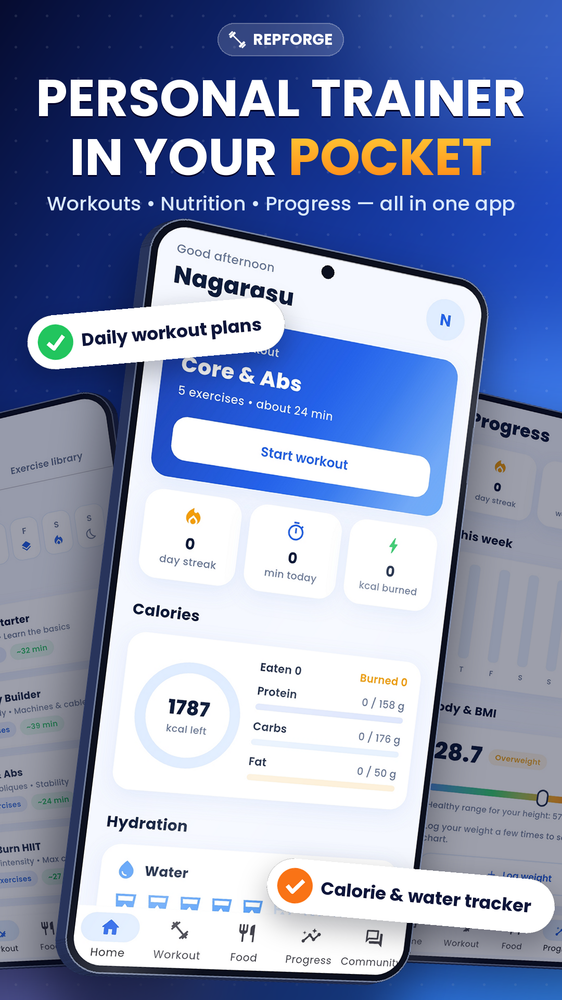
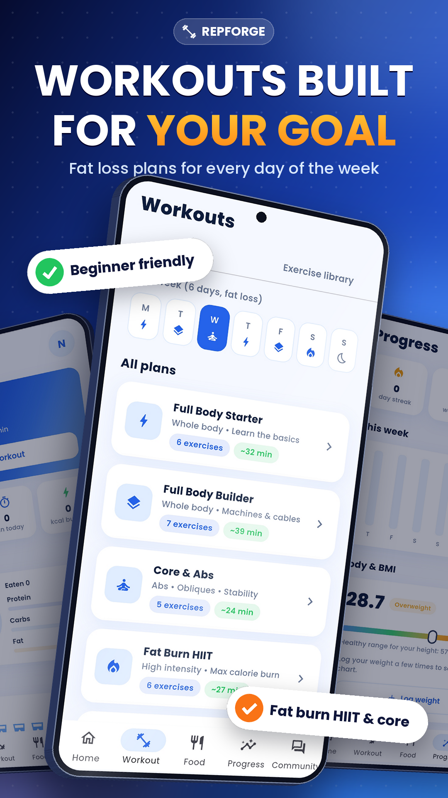
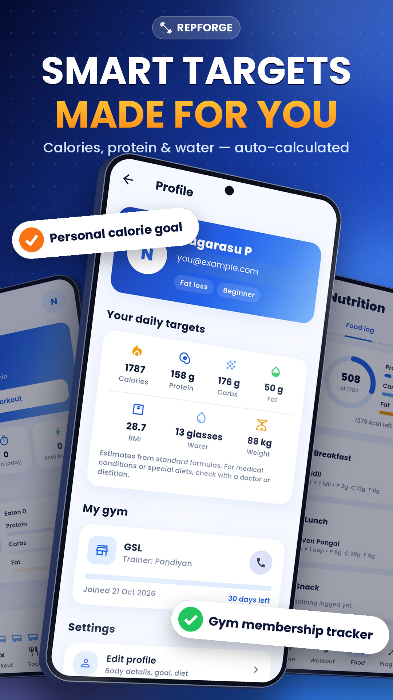
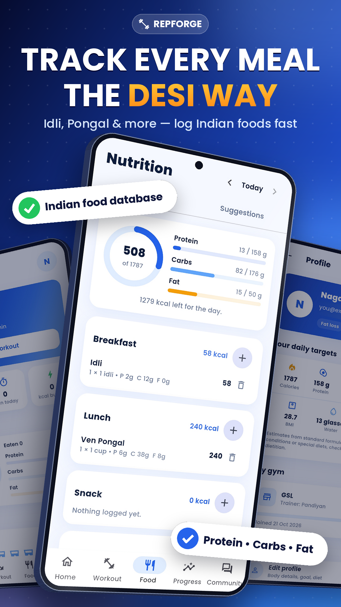
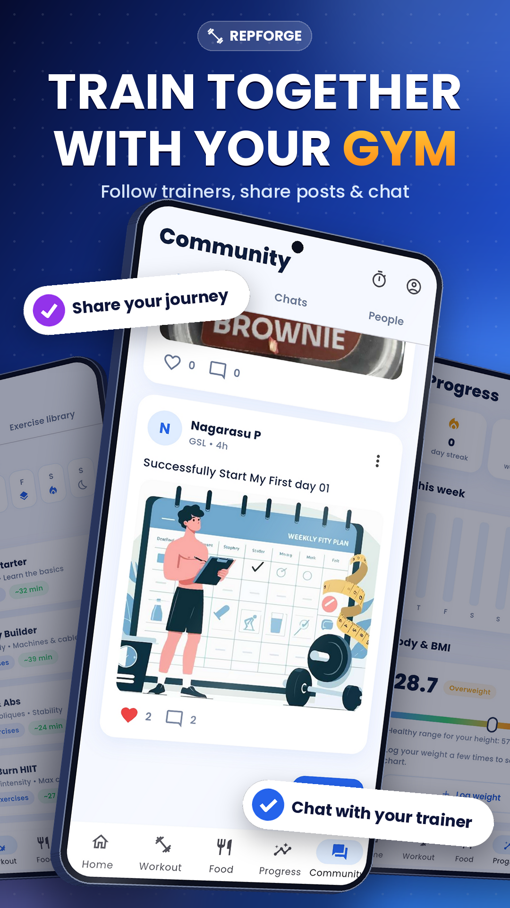
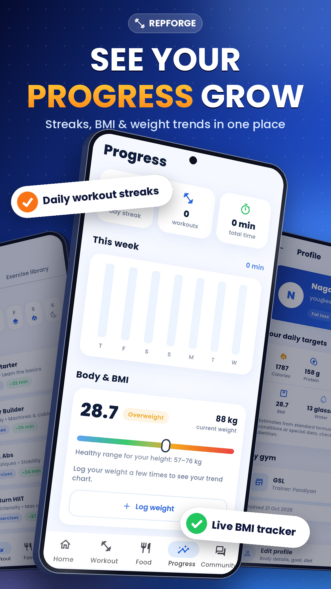

# 💪 RepForge

**Your personal gym trainer in your pocket.**
Workouts with a voice trainer, Indian food tracking, steps, expenses and a gym community, all in one Android app.

[⬇️ Download the APK](https://github.com/Nagarasu0408/RepForge---V1/releases/latest) · [🐞 Report a bug](https://github.com/Nagarasu0408/RepForge---V1/issues)

---

## 📲 Download and install

1. Open the **[Releases](https://github.com/Nagarasu0408/RepForge---V1/releases/tag/Anvaya)** page.
2. Download `RepForge.apk` from **Assets**.
3. Open the file on your Android phone.
4. If asked, allow **Install unknown apps** for your browser or file manager.
5. Open RepForge, sign up with email or Google, and set up your profile.

> Requires Android 6.0 or newer. iOS is not available.

---

## ✨ Features

### 🏋️ Workout and trainer mode
- 10 ready-made plans and 31 exercises with step-by-step instructions and common mistakes
- Weekly schedule made for your goal (fat loss, muscle gain, stay fit) and level
- **Voice trainer:** speaks instructions, counts reps, gives rest-timer cues and motivation
- Session timer, set logging, weight tracking and personal records
- Share your finished workout to the community in one tap

### 🍛 Food and calories
- **175+ Indian foods** (idli, dosa, biryani, parotta, sweets, street food and more)
- Type any food name and the app **estimates calories and macros automatically**
- Gets a **Good choice / Okay in moderation / Better to limit** rating for your goal
- Daily calorie and protein / carbs / fat targets, meal suggestions, water tracker

### 📈 Health and progress
- BMI gauge, weight chart, day-by-day calendar and workout streaks
- **Step counter** with daily goal, distance and calories
- **Time-to-move reminders** if you have been sitting too long
- Badges and a 7-day activity summary

### 💸 Expense tracker
- Track gym fees, supplements, food, equipment and more
- View by **day, week, month or custom date range**
- Category breakdown and daily average (only visible to you)

### 👥 Community
- Follow gymmates and trainers, post updates, ask doubts and answer them
- **Stories** that disappear after 24 hours
- **Chat** with text, photos and view-once snaps
- Message **reactions, replies, edit and delete**
- **Disappearing messages** (1 hour, 24 hours or 7 days)
- Gym membership tracker with trainer details and expiry reminder

### 🔒 You control your privacy
- Private account with follow requests
- Choose who can see each post and story: everyone, only your gym, or followers
- Choose who can message and comment on you
- Read receipts, search visibility, block and report
- Every notification type can be turned on or off

---

## 🖼️ Screenshots

<!-- Add your screenshots in a /screenshots folder and update the names below -->
| Home | Workout | Trainer mode |
|:---:|:---:|:---:|
|  |  |  |

| Food | Community | Expenses |
|:---:|:---:|:---:|
|  |  |  |

---

## 🔐 Permissions

| Permission | Why RepForge needs it |
|---|---|
| Internet | Login, saving your data, community and chat |
| Notifications | Workout, water, meal, move and chat reminders |
| Physical activity | Count your daily steps with the phone's step sensor |
| Camera | Take snaps, story and post photos (only when you choose) |
| Vibration | Haptic cues during workouts |
| Keep screen awake | Stops the screen turning off during a workout |

All permissions are optional features. If you deny one, the rest of the app still works.

---

## 🛡️ Privacy

- Your workouts, food, weight, steps and expenses are stored in **your own account** and are private.
- Only your **name, role, gym, bio, posts and stories** are visible to other members, and you decide who sees them.
- Snaps are deleted from the database after they are opened.
- You can block and report anyone.

Privacy policy: _add your link here_

---

## ⚠️ Good to know

- Calorie, nutrition and step numbers are **estimates**, not medical advice. Talk to a doctor or dietitian for health conditions or special diets.
- Chat notifications arrive while the app is open or running in the background. Fully closed app notifications are not supported yet.
- Post, story and chat privacy settings are applied inside the app. Do not share anything you would not want other gymmates to see.

---

## 🧰 Built with

Flutter · Firebase Authentication · Cloud Firestore · Android

---

## 🗺️ Roadmap

- [ ] Group chats and voice notes
- [ ] Push notifications when the app is closed
- [ ] Weekly challenges and gym leaderboard
- [ ] Meal photo logging

---

## 💬 Feedback

Found a bug or have an idea? Please [open an issue](https://github.com/Nagarasu0408/RepForge---V1/issues). Mention your phone model and Android version for bugs.

---

## 📄 License

The source code is not published. The APK is provided for personal use only.

© 2026 RepForge. All rights reserved.
